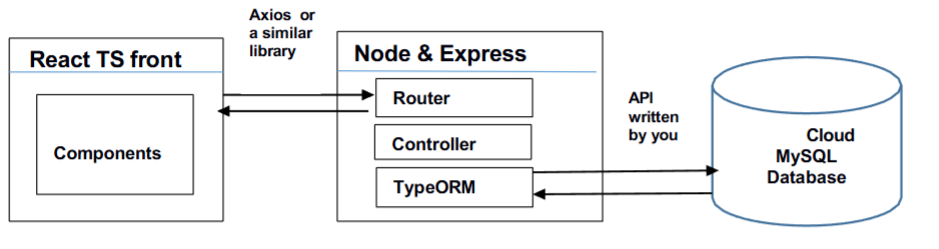

# TeachTeam — Teaching Assistant Hiring Platform

> ⚠️ **ACADEMIC INTEGRITY NOTICE**  
> This is a **university project** completed for **RMIT University - COSC2758: Full Stack Development**.  
> **DO NOT COPY OR REUSE THIS CODE FOR ACADEMIC SUBMISSIONS.**  
> This repository is public for **employment portfolio purposes only**.  
> Any academic use constitutes plagiarism and will be detected.

---

## 🎓 Project Information

**Course:** COSC2758 - Full Stack Development  
**Institution:** RMIT University  
**Semester:** Semester 1, 2025  
**Project Type:** Pair Assignment  
**Grade Received:** Distinction (DI)  
**Status:** ✅ Completed and Graded

---

## 👨‍💻 My Contributions (Jatanjeet Singh)

As a full-stack developer on this project, I contributed to both frontend and backend development:

### Backend Development
- Designed and implemented RESTful API endpoints for user authentication, applications, and course management
- Created TypeORM entities and repository patterns for database operations
- Implemented JWT-based authentication and authorization middleware
- Developed comprehensive input validation on both client and server side
- Built GraphQL API for admin dashboard with queries and mutations
- Wrote database migration scripts and seed data

### Frontend Development
- Built responsive React TypeScript components using functional components and hooks
- Implemented user authentication flows (sign-up, sign-in, logout)
- Created candidate application forms with real-time validation
- Developed lecturer dashboard for viewing and filtering applicants
- Built interactive data visualization components for applicant statistics
- Designed and implemented admin dashboard interface

### Database Design
- Created Entity-Relationship Diagram (ERD) for normalized database schema
- Designed tables for Users, Applications, Courses, Assignments, and User Experience
- Implemented proper relationships, constraints, and indexes
- Ensured database normalization to avoid data redundancy

### DevOps & Architecture
- Set up multi-project architecture (frontend, backend, admin frontend, admin GraphQL backend)
- Configured build processes and environment variable management
- Implemented proper project structure following MVC pattern
- Managed version control with Git and GitHub

---

## 📋 Project Overview

TeachTeam is a comprehensive web-based platform designed to streamline the hiring process for teaching assistants (tutors and lab assistants) at RMIT University. The system supports three user roles:

- **Candidates**: Apply for tutor and/or lab assistant positions across multiple courses
- **Lecturers**: Review applications, filter candidates, and select teaching assistants for their courses
- **Administrators**: Manage courses, assign lecturers, generate reports, and oversee the entire system

The platform provides an intuitive interface for candidates to showcase their skills and availability, while giving lecturers powerful filtering and visualization tools to make informed hiring decisions.

---

## ✨ Key Features

### For Candidates
- User registration and authentication with profile management
- Apply for tutor and/or lab assistant roles across multiple courses
- Track application status and history
- Manage availability and skill sets
- Upload and manage user experience information

### For Lecturers
- View applications for assigned courses only
- Advanced filtering by candidate name, session type, availability, and skills
- Visual representation of applicant statistics
- Select and manage teaching assistants for courses
- Export candidate lists and reports

### For Administrators (Separate Dashboard)
- Assign lecturers to courses for each semester
- Add, edit, and delete courses
- Block/unblock candidate accounts
- Generate comprehensive reports:
  - Candidates selected for each course
  - Candidates chosen for 3+ courses
  - Candidates not selected for any course
- Real-time notifications using GraphQL subscriptions

---

## 🛠️ Technology Stack

### Frontend (Main Application)
- **React 18** with **TypeScript**
- **Vite** for build tooling and development server
- **Tailwind CSS** for styling
- **Axios** for HTTP requests
- **React Router** for navigation
- Functional components with React Hooks

### Frontend (Admin Dashboard)
- **React 18** with **TypeScript**
- **Apollo Client** for GraphQL integration
- **Tailwind CSS** for styling
- **GraphQL Subscriptions** for real-time updates

### Backend (REST API)
- **Node.js** with **Express**
- **TypeScript** for type safety
- **TypeORM** for database operations
- **MySQL** (Cloud-hosted) for data persistence
- **JWT** for authentication
- **bcrypt** for password hashing

### Backend (Admin GraphQL API)
- **Node.js** with **Express**
- **Apollo Server** for GraphQL
- **TypeORM** for database operations
- **MySQL** (Cloud-hosted) for data persistence
- **GraphQL Subscriptions** for real-time features

### Architecture
- **MVC Design Pattern**
- Separate concerns: Frontend, REST API, GraphQL API, Database
- RESTful API design principles
- GraphQL for complex admin queries
- Normalized relational database schema

---

## 🏗️ System Architecture



---

## 🗄️ Database Schema

The application uses a normalized MySQL database with the following main entities:

- **Users** - Stores candidate, lecturer, and admin accounts
- **Courses** - Available courses for the semester
- **Applications** - Candidate applications for roles
- **Course_Assignments** - Lecturer-to-course assignments
- **User_Experience** - Candidate skills and experience
- **Selections** - Lecturer's candidate selections

**Note:** Full Entity-Relationship Diagram (ERD) is included in the backend project folder.

**Key Relationships:**
- One User can have many Applications (one-to-many)
- One Course can have many Applications (one-to-many)
- Many Lecturers can be assigned to many Courses (many-to-many)
- One User can have many User_Experience entries (one-to-many)

---

## 🚀 Installation & Setup

### Prerequisites
- Node.js 16+ and npm
- MySQL database access
- Git

### Environment Setup

Each project requires environment variables. Create `.env` files:

**Backend (.env)**
```env
DB_HOST=your_database_host
DB_PORT=3306
DB_USER=your_database_user
DB_PASSWORD=your_database_password
DB_NAME=your_database_name
VITE_API_URL=http://localhost:5000/api
PORT=5000
```

**Admin Backend (.env)**
```env
DB_HOST=your_database_host
DB_PORT=3306
DB_USER=your_database_user
DB_PASSWORD=your_database_password
DB_NAME=your_database_name
JWT_SECRET=your_jwt_secret_key
PORT=4000
```

### Installation Steps

```bash
# Clone the repository
git clone [repository-url]
cd teachteam

# Install dependencies for all projects
cd frontend && npm install
cd ../backend && npm install
cd ../admin_frontend && npm install
cd ../admin_backend && npm install

# Set up environment variables
# Create .env files as described above

# Initialize database (ensure MySQL is running)
cd backend
npm run typeorm migration:run

# Run all projects
cd frontend && npm run dev        # Main app on port 3000
cd backend && npm run dev         # API on port 5000
cd admin_frontend && npm run dev  # Admin on port 5173
cd admin_backend && npm run dev   # GraphQL on port 4000
```

### Access Points

- **Main Application**: http://localhost:3000
- **Admin Dashboard**: http://localhost:4000

---

## 🧪 Testing

```bash
# Build TypeScript (must compile without errors)
npm run build

# Run backend tests
cd backend
npm test

# Validate TypeORM entities
npm run typeorm schema:log
```

---

## 🎨 Design Features

- **Responsive Navigation Bar** with intuitive sign-in/sign-up
- **Custom Branding** with clickable logo returning to home
- **Modal Sign-In Component** for quick authentication
- **Quick Apply Widget** for easy candidate applications
- **Real-time Alerts** for user feedback on actions
- **Consistent Layout** across all pages (header, main content, footer)
- **Visual Statistics** with color-coded applicant data
- **Status Indicators** ("Not Yet Selected", "Most Selected" badges)
- **Professional Styling** using Tailwind CSS
- **Accessibility Features** with proper ARIA labels

---

## 🎯 Technical Highlights

### Frontend Architecture
- Separation of presentation and business logic
- Reusable component library
- Custom React hooks for data fetching
- Type-safe API calls with TypeScript interfaces
- Optimistic UI updates for better UX

### Backend Architecture
- Clean separation of concerns (Controller → Service → Repository)
- Input validation at multiple layers
- Secure password hashing with bcrypt
- JWT-based stateless authentication
- Error handling middleware
- Database query optimization with proper indexes

### GraphQL Implementation
- Type-safe schema definition
- Efficient query resolution
- Real-time subscriptions for admin notifications
- N+1 query prevention with DataLoader (if implemented)

---

## 📚 Learning Outcomes Achieved

Through this project, I developed expertise in:

✅ **Full-Stack Development**: End-to-end application development from database to UI  
✅ **TypeScript Proficiency**: Type-safe development across entire stack  
✅ **Database Design**: Normalized schema design and optimization  
✅ **API Development**: RESTful and GraphQL API implementation  
✅ **Authentication**: Secure user authentication with JWT  
✅ **React Best Practices**: Functional components, hooks, and state management  
✅ **GraphQL**: Schema design, queries, mutations, and subscriptions  
✅ **DevOps**: Multi-project architecture and environment management  
✅ **Code Quality**: Input validation, error handling, and type safety

---

## 🔧 Key Technical Decisions

### Why Separate Admin Dashboard?
- **Security**: Isolated admin functionality from public application
- **Scalability**: Independent deployment and scaling
- **Technology**: Opportunity to demonstrate GraphQL expertise
- **Performance**: Optimized queries for complex reporting needs

### Why GraphQL for Admin?
- **Efficient Queries**: Fetch exactly the data needed for reports
- **Real-time Updates**: Subscriptions for instant notifications
- **Type Safety**: Auto-generated TypeScript types
- **Flexibility**: Complex filtering and aggregations in single query

### Database Normalization
- Avoided data redundancy
- Ensured data integrity with proper constraints
- Optimized for read and write operations
- Scalable design for future growth

---

## 📧 Contact

**For Employers/Recruiters:**

This project demonstrates my proficiency in modern full-stack development using industry-standard technologies. I successfully implemented a complex multi-user system with separate REST and GraphQL APIs, normalized database design, and responsive React frontends. The project received a Distinction grade.

**Jatanjeet Singh**  
📧 Email: jsgk1056@gmail.com  
💼 LinkedIn: [linkedin.com/in/jatanjeet-singh](https://www.linkedin.com/in/jatanjeet-singh-317961332/)  
🐙 GitHub: [github.com/Wincerys](https://github.com/Wincerys)

---

## 📄 License

```
Copyright (c) 2025 Jatanjeet Singh
All Rights Reserved

ACADEMIC PROJECT - NOT FOR REUSE

This code is provided for portfolio demonstration purposes only.
NOT licensed for use, modification, or distribution.
Academic use constitutes plagiarism and academic dishonesty.
```

---

## 🙏 Acknowledgments

- **Technologies**: React, TypeScript, Node.js, Express, TypeORM, GraphQL, Apollo, MySQL
- **Styling**: Tailwind CSS
- **Build Tools**: Vite
- **Documentation**: RMIT University course materials
- **Icons & Assets**: Sourced from royalty-free resources

---

**Project Status:** ✅ Completed | 🎓 Graded (DI) | 🔒 Academic Portfolio Only

---


*This project was developed as part of RMIT University's Full Stack Development course, demonstrating proficiency in modern web application development using TypeScript, React, Node.js, and both REST and GraphQL APIs.*
